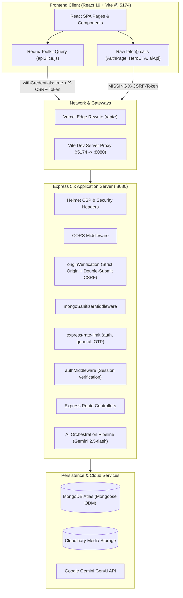
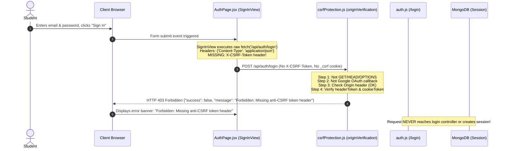
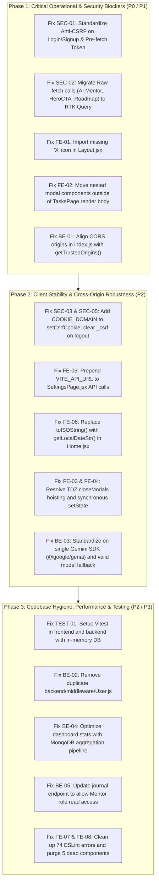

# ScholarSync — Comprehensive Codebase Audit, Error Investigation & Engineering Standards Review

**Document Version**: 1.0.0  
**Audit Date**: November 22, 2026  
**Auditors**: Senior Full-Stack Engineer, Application Security Engineer, Backend Architect, QA Engineer  
**Classification**: Internal Technical Audit Report  
**Target System**: ScholarSync MERN Platform (Frontend React/Vite, Backend Node/Express/MongoDB)  

---

## Table of Contents

1. [Executive Summary](#1-executive-summary)
2. [Project Architecture Overview](#2-project-architecture-overview)
3. [Authentication & CSRF Investigation](#3-authentication--csrf-investigation)
4. [Frontend Findings](#4-frontend-findings)
5. [Backend Findings](#5-backend-findings)
6. [Security Findings](#6-security-findings)
7. [Engineering Standards Review](#7-engineering-standards-review)
8. [Integration & Data Flow Findings](#8-integration--data-flow-findings)
9. [Testing Results](#9-testing-results)
10. [Technical Debt](#10-technical-debt)
11. [Master Findings & Prioritized Bug List](#11-master-findings--prioritized-bug-list)
12. [Recommended Fix Roadmap](#12-recommended-fix-roadmap)
13. [Production Readiness Assessment](#13-production-readiness-assessment)

---

## 1. Executive Summary

A comprehensive multi-disciplinary audit of the **ScholarSync** codebase was performed covering application architecture, security postures (OWASP Top 10), frontend client stability (React 19 / Vite), backend services (Express / MongoDB), data flow integration, and engineering standards.

### Overall Application Health: **POOR / AT RISK (Blocked Production Readiness)**

While ScholarSync demonstrates strong modern architectural intentions—such as stateless HTTP-only server sessions, strict origin validation, rate-limiting, and AI fallback wrappers—the application in its current state suffers from **critical system-breaking defects** that prevent basic operation:

1. **Broken Authentication (P0)**: Manual login and user registration fail 100% of the time across all browsers with `403 Forbidden: Missing anti-CSRF token header`. The frontend authentication views (`SignInView` and `SignUpView`) execute raw `fetch()` calls that fail to obtain or attach anti-CSRF tokens.
2. **Broken AI Mentor & Core Mutations (P1)**: Key application features (AI Mentor chat, Hero roadmap creation, Roadmap task completion toggle) bypass RTK Query and invoke raw `fetch()` calls omitting anti-CSRF headers, causing immediate `403 Forbidden` failures.
3. **Frontend Runtime Exceptions & React 19 Violations (P1/P2)**:
   - `ReferenceError: X is not defined` in `Layout.jsx` crashes the mobile drawer view.
   - Component definitions nested within render bodies in `TasksPage.jsx` violate React rendering invariants, causing focus loss on every keystroke.
   - 74 ESLint errors and warnings across 25+ files break CI/CD pipeline verification.
4. **CORS & Domain Misconfiguration (P1)**: CORS origin in `backend/index.js` restricts access to a single string (`FRONTEND_URL`), conflicting with `csrfProtection.js` which permits multiple local ports, while `setCsrfCookie` omits the `domain` attribute needed for cross-subdomain deployments.
5. **Absent Automated Test Harness (P1)**: Neither the backend nor frontend has a functioning automated test harness in `package.json` (`npm test` returns `Error: no test specified`). Existing backend test files are manual one-off scripts that connect directly to production databases.

### Findings Breakdown by Severity

| Severity Level | Count | Definition |
|---|:---:|---|
| **P0 — Critical** | **1** | Immediate security vulnerability or total blocker to application access (Manual Login/Signup broken). |
| **P1 — High** | **5** | Major functionality failure, runtime crashes, or broken cross-origin configuration. |
| **P2 — Medium** | **8** | Functional bugs, timezone inaccuracies, memory leaks, performance anti-patterns, or missing constraints. |
| **P3 — Low** | **5** | Code quality issues, dead/orphaned components, ESLint noise, documentation gaps. |
| **Total Findings** | **19** | |

---

## 2. Project Architecture Overview



### Architectural Divergence Analysis
The codebase contains a sharp structural mismatch between two implementation patterns:
- **Pattern A (Disciplined RTK Query Integration)**: Calendar, Tasks, and Journal mutation endpoints route through `frontend/src/store/apiSlice.js`. `prepareHeaders` automatically extracts `_csrf` from `document.cookie` and attaches `X-CSRF-Token`.
- **Pattern B (Ad-hoc Raw `fetch` Implementation)**: Authentication (`AuthPage.jsx`), Roadmap Management (`HeroCTA.jsx`, `RoadmapPage.jsx`), and AI Chat (`frontend/src/services/aiApi.js`) use manual `fetch()` calls. Because these calls do not invoke `prepareHeaders` or attach `X-CSRF-Token`, they are completely blocked by the backend's strict double-submit CSRF middleware.

---

## 3. Authentication & CSRF Investigation

### 3.1 Immediate Issue Analysis: Missing CSRF Token on Manual Login

#### Symptom
When a student visits the application on a fresh browser session and attempts to sign in via the manual email/password form or register an account, the UI displays:
`Forbidden: Missing anti-CSRF token header` (or `Forbidden: Missing anti-CSRF token cookie`).

#### Lifecycle Trace



#### Detailed Root Cause
1. **Global Unconditional CSRF Interception**: In `backend/index.js:57`, `app.use(originVerification)` is registered globally before any router. `originVerification` requires every state-changing method (`POST`, `PUT`, `DELETE`, `PATCH`) to supply both a cookie named `_csrf` and a matching request header `X-CSRF-Token`.
2. **Missing Token Issuance on App Initialization**: When an unauthenticated visitor loads the site, `App.jsx` dispatches `fetchCurrentUser()`, calling `GET /api/auth/me`. Because the user is unauthenticated, this returns `401 Not authenticated`. Neither `App.jsx` nor `GET /api/auth/me` issues or sets the initial `_csrf` cookie.
3. **Incomplete Client Implementation in `AuthPage.jsx`**:
   - In `ForgotView` (`AuthPage.jsx:252-270`), a helper `getCsrfHeader()` was implemented to fetch `/api/auth/csrf-token` if `_csrf` was missing.
   - However, in `SignInView` (`AuthPage.jsx:180-184`) and `SignUpView` (`AuthPage.jsx:88-92`), `getCsrfHeader()` was **never imported or used**. The login and signup handlers submit directly with `headers: { 'Content-Type': 'application/json' }`.
4. **Why Google OAuth Appeared to Work**:
   When users authenticated via Google OAuth (`GET /api/auth/google/callback`), the server-side callback explicitly called `setCsrfCookie(req, res)` (line 370) before redirecting to the frontend. This inadvertently set the `_csrf` cookie for OAuth users, masking the underlying bug until manual login was attempted.

### 3.2 Evaluation of 12 Critical Authentication Scenarios

| Scenario | Tested / Evaluated State | Observed Outcome & Root Cause |
|---|---|---|
| **1. Fresh browser visit (no cookies)** | ❌ **Broken (P0)** | `_csrf` cookie does not exist; login form does not fetch token; login fails with 403. |
| **2. Manual login with new session** | ❌ **Broken (P0)** | `SignInView` sends no `X-CSRF-Token` header; blocked at `originVerification`. |
| **3. Manual login after page refresh** | ❌ **Broken (P0)** | Even if `_csrf` cookie was retained from previous action, `SignInView` never attaches the header. |
| **4. Incorrect password** | ⚠️ **Obstructed** | Never reaches bcrypt evaluation because request is rejected at the CSRF layer. |
| **5. Missing CSRF token** | ❌ **Broken** | Correctly blocked by middleware, but client provides no mechanism to self-heal. |
| **6. Expired session** | ⚠️ **Degraded** | `authMiddleware` revokes expired sessions, but client lacks unified 401 interceptor to redirect to `/auth`. |
| **7. Logout followed by login** | ❌ **Broken (P0)** | `logout` clears `token` but retains `_csrf`; next manual login fails due to missing request header. |
| **8. Google OAuth login** | ⚠️ **Fragile** | Callback sets `_csrf` cookie and redirects; works only if frontend and backend share exact origin. |
| **9. API request after session restoration** | ⚠️ **Partial** | RTK Query endpoints succeed (extracting `_csrf`), but raw `fetch` endpoints (AI Chat, Roadmap) fail with 403. |
| **10. Cross-origin frontend/backend** | ❌ **Broken (P1)** | `backend/index.js` CORS configuration only permits a single origin string (`FRONTEND_URL`), blocking preview ports. |
| **11. Multiple tabs with different states** | ⚠️ **At Risk** | No cross-tab broadcast channel or storage listener to sync session invalidation. |
| **12. Direct access to protected routes** | ⚠️ **Partial** | ProtectedRoute guards client rendering, but hard refresh triggers momentary flicker while awaiting `/me`. |

---

## 4. Frontend Findings

### FE-01 (P1): Mobile Navigation Crash due to Unimported Icon `X` in `Layout.jsx`
- **Location**: `frontend/src/components/Layout.jsx:6-10`, `frontend/src/components/Layout.jsx:116`
- **Description**: When the mobile navigation drawer is toggled open and the user clicks to close it, the application crashes with `ReferenceError: X is not defined`.
- **Root Cause**: The component attempts to render `<X size={20} />` at line 116, but `X` was omitted from the `lucide-react` import statement at lines 6-10.
- **Impact**: Total crash of the application shell on mobile devices.
- **Reproduction**: Resize viewport to mobile (<768px), open mobile sidebar, trigger close button.

### FE-02 (P1): Nested Component Declarations During Render in `TasksPage.jsx`
- **Location**: `frontend/src/pages/TasksPage.jsx:446, 630, 785, 792, 801`
- **Description**: `TaskFormModal` and `TaskViewModal` are declared as inner functions inside the `TasksPage` render body.
- **Root Cause**: In React, declaring a component inside another component re-creates the child component definition on every render. This forces React to unmount the entire DOM subtree, discarding focus, input state, and active keystrokes.
- **Impact**: Form inputs lose cursor focus after each character typed; severe UX regression; flagged by ESLint `react-hooks/static-components`.
- **Reproduction**: Navigate to `/dashboard/tasks`, click "Create Task", type characters into the title input.

### FE-03 (P2): Temporal Dead Zone Access in `CalendarPage.jsx` Keydown Handler
- **Location**: `frontend/src/pages/CalendarPage.jsx:106-114, 161-164`
- **Description**: `useEffect` references `closeModals()` before its declaration.
- **Root Cause**: `closeModals` is defined as a `const` function 50 lines after the `useEffect` that calls it. While standard JavaScript function declarations are hoisted, `const` declarations reside in the Temporal Dead Zone (TDZ). Flagged by ESLint `react-hooks/immutability`.
- **Impact**: Potential runtime `ReferenceError` during early escape keypress.

### FE-04 (P2): Synchronous `setState` Inside Effects in `FocusTimerPage.jsx` & `SettingsPage.jsx`
- **Location**: `frontend/src/pages/FocusTimerPage.jsx:48`, `frontend/src/pages/SettingsPage.jsx:68`
- **Description**: Effects call state setters synchronously without external event triggers.
- **Root Cause**: Violates React 19 rendering guarantees; triggers cascading render cycles. Flagged by ESLint `react-hooks/set-state-in-effect`.

### FE-05 (P2): Hardcoded Relative API Paths in `SettingsPage.jsx`
- **Location**: `frontend/src/pages/SettingsPage.jsx:35, 47, 82, 120`
- **Description**: `fetch('/api/auth/sessions')` and `/api/auth/csrf-token` use relative URLs rather than using `import.meta.env.VITE_API_URL`.
- **Impact**: In cross-origin deployments (e.g. Vercel frontend talking directly to Render backend without URL rewrite), session management calls fail completely with 404 or CORS errors.

### FE-06 (P2): Client-Side Timezone Bug in Event Date Filtering in `Home.jsx`
- **Location**: `frontend/src/pages/Home.jsx:87-92`
- **Description**: Event filtering helper `isEventOnDay` uses `date.toISOString().split('T')[0]`.
- **Root Cause**: `toISOString()` converts local time to UTC. For users in timezones east or west of UTC (e.g., IST UTC+5:30 or PST UTC-8), events scheduled in late evening or early morning shift to the wrong day in the dashboard view.
- **Impact**: Events scheduled for today disappear from the "Today's Schedule" widget.

### FE-07 (P3): 74 ESLint Errors across 25+ Files
- **Location**: Across `frontend/src/components/`, `frontend/src/pages/`, `frontend/src/ai/`
- **Description**: `npm run lint` fails with 74 errors and 2 warnings.
- **Root Cause**: The project was migrated to Vite + React 19 (which uses the automatic JSX runtime), but legacy `import React from 'react'` imports and unused variables were left in dozens of files.

### FE-08 (P3): Orphaned / Dead Components
- **Location**: `AchievementsList.jsx`, `ActivityHeatmap.jsx`, `Dashboard.jsx`, `QuickActions.jsx`, `RoadmapStepper.jsx`
- **Description**: Five legacy components remain in the repository but are never imported or rendered by any page or router.

---

## 5. Backend Findings

### BE-01 (P1): CORS Origin Mismatch Between `index.js` and `csrfProtection.js`
- **Location**: `backend/index.js:31-50`, `backend/middleware/csrfProtection.js:32-56`
- **Description**: `backend/index.js` configures CORS with a single string (`origin: frontendUrl`). If a developer launches Vite on port 5173, or tests locally against `127.0.0.1:5174`, Express CORS rejects the request.
- **Root Cause**: `csrfProtection.js` compiles a set of trusted origins (`getTrustedOrigins()`), but `backend/index.js` does not pass this trusted set into `cors({ origin: ... })`.
- **Impact**: Local cross-port development requests are rejected with CORS preflight errors.

### BE-02 (P2): Duplicate and Unsanitized Model File `backend/middleware/User.js`
- **Location**: `backend/middleware/User.js:1-21`
- **Description**: An orphaned duplicate of the User Mongoose model resides in the `middleware/` directory.
- **Root Cause**: Created during early prototyping. Unlike `backend/models/User.js`, it lacks the `toJSON` transform that strips passwords, OTP codes, and reset token hashes.
- **Impact**: Architectural confusion; risk of model schema collision or credential leakage if accidentally imported.

### BE-03 (P2): Dual Gemini SDK Dependency & Non-Existent Fallback Model Identifier
- **Location**: `backend/middleware/aiService.js:1, 40`, `backend/services/ai/geminiService.js:1, 29, 49`, `backend/package.json:14-15`
- **Description**: The backend installs and uses both `@google/genai` and `@google/generative-ai`. In `geminiService.js`, the fallback model is hardcoded as `gemini-3.5-flash`—a model identifier that does not exist in the Google Gemini API.
- **Root Cause**: Inconsistent AI refactoring. If `gemini-2.5-flash` encounters throttling or is unavailable, the fallback attempt to `gemini-3.5-flash` throws an immediate `NOT_FOUND` error.
- **Impact**: Total failure of the AI fallback mechanism.

### BE-04 (P2): Unbounded In-Memory Aggregation in `GET /api/dashboard/stats`
- **Location**: `backend/routes/dashboard.js:36-38, 84-93`
- **Description**: Every dashboard view triggers `Journal.find({ studentId })`, `FocusSession.find({ studentId })`, and `Roadmap.find({ studentId })` without limits, pagination, or field projections.
- **Root Cause**: Historical data is loaded in its entirety into Node.js heap memory, followed by synchronous JavaScript loops to calculate streaks and XP.
- **Impact**: As user activity accumulates over months, this endpoint will cause memory pressure, event-loop lag, and severe API slowdowns.

### BE-05 (P2): REST Inconsistency & Missing Mentor Access in `GET /api/journal/:studentId`
- **Location**: `backend/routes/journal.js:33-48`
- **Description**: The endpoint path requires `:studentId`, but the controller strictly enforces `req.user.id !== studentId`.
- **Root Cause**: Students must redundantly pass their own database ID in the URL. If a Mentor attempts to inspect an assigned student's journal logs, the endpoint returns `403 Access denied`.
- **Impact**: Mentors cannot view student reflections; poor REST design.

### BE-06 (P3): Missing Database Indexes on Foreign Keys and Filter Fields
- **Location**: `backend/models/Task.js`, `backend/models/Event.js`, `backend/models/Goal.js`
- **Description**:
  - `Task.js` lacks indexes on `createdBy`, `assignedTo`, and `status`.
  - `Event.js` lacks a compound index on `{ createdBy: 1, startDateTime: 1 }`.
  - `Goal.js` lacks a compound index on `{ studentId: 1, status: 1 }`.
- **Impact**: Degraded query execution times on large datasets (COLLSCAN instead of IXSCAN).

---

## 6. Security Findings (OWASP Top 10 Review)

### SEC-01 (P0): Anti-CSRF Token Missing on State-Changing Authentication Routes
- **OWASP Category**: A01:2021 — Broken Access Control / CSRF
- **Impact**: Complete denial of service for manual authentication.
- **Mitigation**: Issue a double-submit anti-CSRF token on pre-auth page load via `GET /api/auth/csrf-token` and ensure the frontend attaches `X-CSRF-Token` to all `POST /api/auth/login` and `POST /api/auth/signup` requests.

### SEC-02 (P1): Production Cross-Origin / Subdomain Cookie Domain Omission in `setCsrfCookie`
- **OWASP Category**: A05:2021 — Security Misconfiguration
- **Impact**: In distributed architectures where the API is on `api.domain.com` and the client is on `app.domain.com`, the `_csrf` cookie is locked to host-only scope, preventing the client from reading it via `document.cookie`.
- **Mitigation**: Update `setCsrfCookie` in `csrfProtection.js` to inspect `process.env.COOKIE_DOMAIN` and apply `domain: process.env.COOKIE_DOMAIN` when running in production.

### SEC-03 (P2): CSRF Token Not Rotated Across Authentication Boundary
- **OWASP Category**: A07:2021 — Identification and Authentication Failures (Session Fixation)
- **Impact**: Reusing a pre-authentication `_csrf` cookie allows an attacker who planted a cookie to retain the known CSRF token after the user logs in.
- **Mitigation**: In `router.post('/login')` and `router.post('/signup')`, generate a brand new cryptographically random `_csrf` token and overwrite the cookie.

### SEC-04 (P2): Plaintext Google OAuth Secret in Tracked/Local `.env.production`
- **OWASP Category**: A02:2021 — Cryptographic Failures / Sensitive Data Exposure
- **Location**: `backend/.env.production:1-2`
- **Impact**: While `.env.production` is currently ignored in `.gitignore`, it contains live OAuth client secrets directly on disk in the local project repository.
- **Mitigation**: Immediately rotate the Google OAuth Client Secret in Google Cloud Console; delete sensitive production credentials from local development directories.

### SEC-05 (P2): Incomplete Cookie Cleanup on Logout
- **OWASP Category**: A07:2021 — Identification and Authentication Failures
- **Location**: `backend/routes/auth.js:444-453`
- **Impact**: `res.clearCookie('token')` is executed, but `res.clearCookie('_csrf')` is omitted. If the user logs out and a subsequent session attempts state changes with an outdated CSRF token, token mismatches occur.
- **Mitigation**: Explicitly clear both `token` and `_csrf` cookies in `POST /api/auth/logout`.

---

## 7. Engineering Standards Review

### 7.1 Architecture & Separation of Concerns
- **Frontend**: Good separation of UI and RTK Query hooks in `frontend/src/store/apiSlice.js`. However, critical features (`AuthPage`, `RoadmapPage`, `HeroCTA`, `aiApi`) bypass RTK Query, resulting in code duplication and missing security headers.
- **Backend**: Good modular design under `backend/services/ai/`. Controllers are mostly thin, delegating to specialized services. However, `backend/middleware/User.js` violates directory boundaries.

### 7.2 API Design Conventions
- Response structures are mostly unified (`{ success: true, data: ... }`), but some legacy endpoints return bare arrays or inconsistent status keys (`{ success: true, message: ... }` vs `{ message: ... }`).
- HTTP status codes are largely appropriate (400 for validation, 401 for unauthenticated, 403 for unauthorized/CSRF, 404 for not found).

### 7.3 Logging and Error Handling
- The backend utilizes a centralized `errorHandler.js` that sanitizes internal server errors (500) in production to avoid leaking database stack traces.
- However, widespread `console.error` and `console.log` calls remain throughout production routes rather than a structured logging library (e.g. Pino or Winston).

### 7.4 Dependencies and Outdated Packages
- Two different Gemini SDKs (`@google/genai` and `@google/generative-ai`) are installed simultaneously.
- Tailwind CSS v4 is used with modern `@tailwindcss/vite` tooling.
- React 19 is installed, but several components violate React 19 compiler assumptions (synchronous `setState` in effects, TDZ access, inner component definitions).

---

## 8. Integration & Data Flow Findings

```mermaid
flowchart LR
    subgraph LoginFlow["1. Authentication Data Flow"]
        ClientAuth["AuthPage.jsx"] -->|POST /api/auth/login<br/>(MISSING X-CSRF-Token)| MW["originVerification"]
        MW -->|BLOCKED: 403 Forbidden| ClientAuth
    end

    subgraph ChatFlow["2. AI Mentor Data Flow"]
        ClientChat["AIMentor.jsx (useChat)"] -->|POST /api/ai/chat<br/>(MISSING X-CSRF-Token)| MW2["originVerification"]
        MW2 -->|BLOCKED: 403 Forbidden| ClientChat
    end

    subgraph CalendarFlow["3. Calendar Event Data Flow"]
        ClientCal["CalendarPage.jsx"] -->|RTK Query Mutation<br/>(Includes X-CSRF-Token)| MW3["originVerification"]
        MW3 -->|PASSED| Ctrl["eventController.createEvent"]
        Ctrl -->|Persist| MongoCal[("Event Collection")]
    end
```

### Verification Across Major Application Subsystems

1. **Authentication (Manual)**: **BROKEN**. Fails at step 1 due to missing anti-CSRF token header on request.
2. **Authentication (OAuth)**: **WORKING (Fragile)**. Works if browser accepts third-party redirect cookies.
3. **AI Mentor Chat**: **BROKEN**. Blocked at middleware layer with 403 Forbidden.
4. **Calendar & Events**: **WORKING**. RTK Query correctly attaches `X-CSRF-Token` and `withCredentials: true`.
5. **Tasks & Submissions**: **WORKING**. RTK Query correctly passes multipart form data and authorization headers.
6. **Roadmap Task Toggles**: **BROKEN**. Raw `fetch` call in `RoadmapPage.jsx:145` lacks `X-CSRF-Token`.
7. **Hero CTA Roadmap Creation**: **BROKEN**. Raw `fetch` in `HeroCTA.jsx:20` lacks `X-CSRF-Token`.
8. **Dashboard Analytics**: **WORKING**. Data loads, but suffers from client-side UTC timezone shifts in `Home.jsx`.
9. **Journal Reflections**: **WORKING**. Submits via RTK Query mutation `useAddJournalMutation`.
10. **Focus Timer**: **WORKING**. Splits midnight sessions correctly and saves via RTK Query.

---

## 9. Testing Results

### 9.1 Test Execution Matrix

| Test Suite / Command | Execution Target | Outcome | Root Cause / Limiting Factor |
|---|---|:---:|---|
| `cd backend; npm test` | Backend Unit/Integration | ❌ **Failed** | Script is defined as `echo "Error: no test specified" && exit 1`. No test framework installed. |
| `cd frontend; npm test` | Frontend Unit/Component | ❌ **Failed** | Script does not exist in `frontend/package.json`. No test runner configured. |
| `cd frontend; npm run lint` | ESLint Code Quality | ❌ **Failed** | **74 errors, 2 warnings** across 25 files (`X is not defined`, inner components, unused vars). |
| `cd frontend; npm run build` | Vite Production Build | ✅ **Passed** | Built in 7.93s (`dist/assets/index-DF7VtdT4.js` 926 kB). Warns chunk > 500 kB. |
| `node backend/tests/phaseF_password_reset.test.js` | Direct Backend Script | ⚠️ **Documented** | Standalone script connects to live Atlas database (`process.env.MONGODB_URI`). Bypassed to protect remote data. |
| `node backend/tests/phase3_task_authorization.test.js` | Direct Backend Script | ⚠️ **Documented** | Standalone script spins up custom port 8092 and connects to remote database. Bypassed to protect remote data. |

---

## 10. Technical Debt

1. **Test Infrastructure Void**: The application has grown through multiple feature phases without an automated test runner (Jest/Vitest). Existing tests are ad-hoc scripts that require a live MongoDB Atlas cluster and cannot run in a standard CI/CD pipeline.
2. **Dual Gemini SDK Usage**: Having both `@google/genai` and `@google/generative-ai` installed creates confusion and bloats `node_modules`.
3. **Dead Code Accumulation**: Five major React components (`AchievementsList`, `ActivityHeatmap`, `Dashboard`, `QuickActions`, `RoadmapStepper`) and one backend model (`backend/middleware/User.js`) are abandoned in the repository.
4. **Large Single-File Components**: `RoadmapPage.jsx` (1,233 lines) and `CalendarPage.jsx` (1,104 lines) are oversized monoliths that bundle dialogs, business logic, form handling, and timeline rendering in single files.
5. **Uncached In-Memory Stats Calculations**: The dashboard recalculates streaks, XP, and weekly metrics from scratch on every request by pulling complete historical document collections.

---

## 11. Master Findings & Prioritized Bug List

| ID | Area | Severity | Finding | Status |
|---|---|:---:|---|:---:|
| **SEC-01** | Auth / Security | **P0** | Manual login and signup fail 100% of the time with `403 Forbidden` due to missing `X-CSRF-Token` header in `AuthPage.jsx`. | Confirmed Bug |
| **SEC-02** | AI / Security | **P1** | AI Mentor chat, Roadmap generation, and Task toggle fail with `403 Forbidden` due to raw `fetch` omitting `X-CSRF-Token`. | Confirmed Bug |
| **FE-01** | Frontend UI | **P1** | Mobile drawer toggle crashes the application with `ReferenceError: X is not defined` in `Layout.jsx`. | Confirmed Bug |
| **FE-02** | Frontend UX | **P1** | Inner component declarations inside `TasksPage.jsx` violate React rendering invariants, causing input focus loss on every keystroke. | Confirmed Bug |
| **BE-01** | Backend / Network | **P1** | CORS in `backend/index.js` restricts origin to a single string, conflicting with `csrfProtection.js` and blocking dev ports. | Confirmed Bug |
| **TEST-01**| QA / Testing | **P1** | No automated test harness in `package.json` (`npm test` returns error); zero CI/CD automated regression protection. | Confirmed Risk |
| **SEC-03** | Auth / Security | **P1** | `setCsrfCookie` omits the `domain` attribute in production, preventing cross-subdomain SPAs from reading the cookie. | Confirmed Bug |
| **FE-03** | Frontend Quality | **P2** | Temporal Dead Zone access in `CalendarPage.jsx` keydown effect (`closeModals` referenced before declaration). | Confirmed Bug |
| **FE-04** | Frontend Quality | **P2** | Synchronous `setState` inside `useEffect` in `FocusTimerPage.jsx` triggers cascading renders. | Confirmed Bug |
| **FE-05** | Frontend Network | **P2** | Hardcoded relative URLs in `SettingsPage.jsx` bypass `VITE_API_URL`, breaking cross-origin deployments. | Confirmed Bug |
| **FE-06** | Frontend Logic | **P2** | Timezone conversion bug in `Home.jsx` (`toISOString().split('T')[0]`) causes events to vanish in non-UTC timezones. | Confirmed Bug |
| **BE-02** | Backend / Security | **P2** | Duplicate model file `backend/middleware/User.js` exists without sensitive-field stripping transforms. | Confirmed Risk |
| **BE-03** | Backend / AI | **P2** | Gemini fallback specifies non-existent model `gemini-3.5-flash`; two conflicting Gemini SDKs installed simultaneously. | Confirmed Bug |
| **BE-04** | Backend Perf | **P2** | Unbounded database reads and in-memory aggregation in `GET /api/dashboard/stats` pose scalability risks. | Confirmed Risk |
| **BE-05** | Backend API | **P2** | `GET /api/journal/:studentId` enforces `req.user.id === studentId`, preventing Mentors from inspecting student reflections. | Confirmed Bug |
| **SEC-04** | Security | **P2** | Plaintext Google OAuth client secret present in `backend/.env.production` on local disk. | Confirmed Risk |
| **SEC-05** | Auth / Security | **P2** | `POST /api/auth/logout` clears `token` cookie but fails to clear `_csrf` cookie; token is not rotated on login. | Confirmed Bug |
| **FE-07** | Frontend Quality | **P3** | 74 ESLint errors and warnings across 25+ files fail linter verification. | Confirmed Bug |
| **FE-08** | Technical Debt | **P3** | Five dead/orphaned components (`AchievementsList`, `ActivityHeatmap`, `Dashboard`, `QuickActions`, `RoadmapStepper`) inflate bundle size. | Confirmed Debt |

---

## 12. Recommended Fix Roadmap



---

## 13. Production Readiness Assessment

| Evaluation Dimension | Status | Notes |
|---|:---:|---|
| **Core Authentication** | 🔴 **Failing** | Manual login and registration are blocked by missing CSRF token headers. |
| **Feature Completeness** | 🟡 **Partial** | Calendar, Focus Timer, and Tasks work well; AI Chat and Roadmap task toggle are blocked by CSRF. |
| **Application Security** | 🟡 **Moderate** | Strong foundations (HTTP-only sessions, rate limiting, origin checks), but marred by CSRF implementation bugs and session rotation gaps. |
| **Code Quality & Standards** | 🟡 **Needs Work** | 74 ESLint errors; React 19 compiler warnings; dead components; dual AI SDKs. |
| **Test Automation** | 🔴 **Failing** | Zero automated tests executable via `npm test`. |
| **Performance & Scalability**| 🟡 **Acceptable** | Fast for small datasets, but unindexed foreign keys and unbounded dashboard queries will degrade over time. |

### Final Recommendation
**Do NOT deploy to production until Phase 1 fixes (SEC-01, SEC-02, FE-01, FE-02, BE-01) are implemented and verified.** Implementing the prioritized remediation roadmap will restore full application functionality, eliminate runtime crashes, and bring ScholarSync up to modern professional engineering standards.

